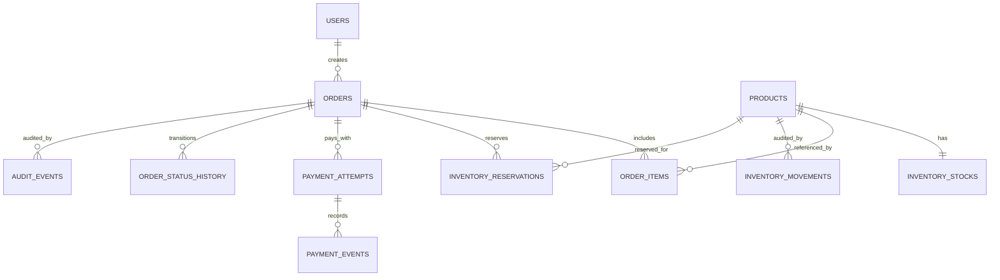

# ORDERLAB — Documento maestro de producto, arquitectura e ingeniería

> **Versión:** 1.0 · **Fecha:** 2026-11-24 · **Estado:** especificación para implementar y validar, no una auditoría del código existente.  
> **Ámbito:** solo **OrderLab**, la aplicación de pedidos en Laravel. **OpsPilot AI no se implementa ni se diseña aquí**.  
> **Repositorio existente:** la raíz ya es una aplicación Laravel (carpetas `app/`, `bootstrap/`, `routes/`, `resources/`, `tests/`, `public/`, `vendor/`; aparecen Vite, TypeScript y componentes frontend). **No inicializar Laravel de nuevo ni sobrescribir sus archivos existentes.**  
> **Decisiones de infraestructura del propietario:** **MySQL externo y administrado por el propietario; MySQL NO forma parte de Docker Compose**. El usuario crea/provisiona la base y credenciales. Docker contendrá solamente la aplicación Laravel y servicios auxiliares necesarios.  
> **Fuente de buenas prácticas para adaptar a Codex:** [coollabsio/coolify — `.claude/skills`](https://github.com/coollabsio/coolify/tree/main/.claude/skills), principalmente `laravel-best-practices` y `testing-best-practices`. Sus ideas se adaptan a **skills de Codex bajo `.agents/skills/`**; **no se utilizará `.claude/skills/`**.

---

## 0. Cómo utilizar este documento

Este documento es el contrato funcional y técnico que deben seguir la persona desarrolladora, Codex y los subagentes. Está preparado para guardarse en `docs/ORDERLAB_MASTER.md` dentro del **Laravel existente**.

**Orden obligatorio de trabajo:** inspeccionar repositorio → identificar convenciones y dependencias instaladas → proponer un cambio acotado → aprobar decisiones que afecten reglas o arquitectura → implementar → pruebas reales → revisión QA independiente → registrar resultados y aprendizaje. Una propuesta escrita **no equivale** a una funcionalidad implementada ni probada.

### 0.1 Semántica de decisiones

- **CONFIRMADO:** expresamente definido por el propietario o evidenciado en el contexto.
- **PROPUESTO:** especificación de diseño para arrancar; podrá ajustarse antes de implementar una historia que dependa de ella.
- **PENDIENTE:** falta inspección o una decisión explícita; un agente no deberá inventar esa respuesta.

| ID      | Decisión                                 | Estado                 | Regla                                                                                               |
| ------- | ---------------------------------------- | ---------------------- | --------------------------------------------------------------------------------------------------- |
| ADR-001 | Laravel ya creado en raíz                | CONFIRMADO             | Conservar proyecto, versiones y starter kit; no reinstalar.                                         |
| ADR-002 | MySQL en infraestructura independiente   | CONFIRMADO             | No crear servicio MySQL en `compose.yaml`; propietario provisiona bases/cuentas.                    |
| ADR-003 | Arquitectura monolito modular            | PROPUESTO              | Una aplicación Laravel, módulos lógicos y límites claros.                                           |
| ADR-004 | API REST versionada + frontend existente | PROPUESTO              | API primero; no borrar ni reemplazar frontend que ya exista.                                        |
| ADR-005 | Redis auxiliar en Docker                 | PROPUESTO              | Caché y jobs; no introducir si no se necesita o ya existe alternativa validada.                     |
| ADR-006 | PHP 8.4 + Laravel 13                     | REPORTADO PREVIAMENTE  | Comprobar versiones reales con `php -v`, `php artisan --version`, `composer.json`.                  |
| ADR-007 | MySQL 8.4 LTS / InnoDB / utf8mb4         | PROPUESTO              | Confirmar versión real del servidor externo antes de migraciones o constraints.                     |
| ADR-008 | Moneda del MVP ARS                       | PROPUESTO              | Una moneda, almacenar importes en unidades menores enteras.                                         |
| ADR-009 | Pagos simulados y ninguna pasarela real  | CONFIRMADO POR ALCANCE | Sin dinero real, tarjetas reales ni integraciones bancarias.                                        |
| ADR-010 | Skill y subagentes exclusivos de Codex   | CONFIRMADO             | Skills en `.agents/skills`, agentes en `.codex/agents`; instrucciones generales en `AGENTS.md`.     |
| ADR-011 | Autenticación/autorización               | PENDIENTE              | Inspeccionar starter kit; elegir Sanctum u opción nativa compatible.                                |
| ADR-012 | Framework de tests                       | PENDIENTE              | Inspeccionar si PHPUnit o Pest está instalado; mantener lo existente inicialmente.                  |
| ADR-013 | Motor frontend                           | PENDIENTE              | Investigar qué son `components.json`, `vite.config.ts`, `tsconfig.json`; no asumir Blade/Vue/React. |

### 0.2 Exclusiones explícitas

En OrderLab **no** se construyen agentes LLM de diagnóstico, RAG, embeddings, orquestadores Python, servidores MCP de OpsPilot ni un segundo backend de IA. El equipo de desarrollo **sí puede usar Codex** con skills, QA y subagentes para construir OrderLab. No confundir ambos sistemas.

---

## 1. Visión del producto

**OrderLab** es una aplicación profesional de comercio electrónico de laboratorio, con enfoque en backend, diseñada para practicar reglas de negocio, consistencia de datos, concurrencia, colas, observabilidad y pruebas. Su comportamiento debe ser realista, aunque las compras y los pagos sean **simulados**.

### 1.1 Objetivos

1. Crear un catálogo administrable y consultable.
2. Mantener inventario exacto y trazable, sin sobreventas.
3. Generar pedidos consistentes, con snapshots de precio e idempotencia.
4. Procesar pagos ficticios con resultados reproducibles, eventos e historial.
5. Ejecutar tareas de segundo plano sin duplicar efectos.
6. Producir logs y métricas que permitan reproducir e investigar incidentes.
7. Aplicar convenciones de Laravel 13, análisis estático, tests, CI y revisión de seguridad.
8. Poder escalar horizontalmente la capa HTTP/worker sin modificar el dominio.

### 1.2 Roles previstos

- **Visitante:** consulta catálogo público, si se habilita.
- **Cliente:** gestiona sus pedidos propios y estado de pago simulado.
- **Administrador:** configura productos, disponibilidad y escenarios operativos autorizados.
- **Operador:** consulta pedidos e incidentes; sin permiso implícito para mutar finanzas o configuración.
- **QA del laboratorio:** genera fallos controlados solo en un entorno aislado y explícitamente habilitado.

**Aislamiento:** la autorización siempre se valida en servidor, con Policies/Gates y filtros de alcance; no basta con ocultar botones. Por defecto, un cliente no accede a pedidos de otros clientes.

### 1.3 Entregas

- **MVP 1:** catálogo, inventario, checkout, pedido, pago simulado, jobs y tests críticos.
- **MVP 2:** panel operativo mínimo, métricas, logs estructurados, auditoría y laboratorio de incidentes.
- **Evolución:** envíos simulados, devoluciones, compensaciones y pruebas de carga más avanzadas.

---

## 2. Arquitectura y principios

### 2.1 Monolito modular (no microservicios prematuros)

Una aplicación desplegable de Laravel, una base de datos MySQL externa, Redis opcional como apoyo, procesos separados para HTTP/cola/scheduler y módulos de negocio con APIs internas explícitas. Un módulo no debe modificar directamente tablas privadas de otro como atajo de negocio: coordina mediante casos de uso/contratos de aplicación, y la transacción necesaria es responsabilidad del caso de uso coordinador.

```text
Navegador / cliente API
        |
    HTTPS / reverse proxy
        |
 Nginx (Docker) -> PHP-FPM / Laravel (Docker)
                         |
          +--------------+----------------+
          |              |                |
       Catalog        Inventory         Orders
          |              |                |
          +--------------+----------------+
                         |
                      Payments
                         |
            MySQL EXTERNO (InnoDB)
                         |
                 Eventos de dominio
                         |
                    Redis (Docker)
                         |
            Queue worker / Scheduler
                         |
               Logs / métricas / audit
```

MySQL es **independiente de Docker**, no un servicio ni un volumen del `compose.yaml`. Las bases `orderlab_dev`, `orderlab_test` (y, cuando corresponda, `orderlab_staging`/`orderlab_prod`) deben existir y estar aisladas mediante credenciales y privilegios específicos.

### 2.2 Principios obligatorios

- **Convenciones Laravel primero:** Requests, Policies, API Resources, Events, Jobs, Eloquent, Query Builder, Exceptions y configuración nativa antes de agregar capas propias.
- **SOLID pragmático:** inyección de dependencias y contratos solo donde hay una frontera real o pruebas lo justifican; evitar interfaces `IProductRepository` redundantes sobre Eloquent.
- **KISS / YAGNI / DRY razonables:** no fabricar patrones abstractos, microservicios, event sourcing o CQRS completo sin evidencia.
- **Invariantes en dos niveles:** lógica en casos de uso y constraints/índices en MySQL. Ningún controlador gestiona transacciones complicadas por su cuenta.
- **Cambios pequeños:** cada PR aborda una responsabilidad verificable y tiene pruebas.
- **Fallos explícitos:** se registran errores operativos sin exponer secretos ni información de otros usuarios.
- **Reproducibilidad:** código, migraciones, locks de dependencias y configuración de desarrollo versionados; datos y secretos fuera del repositorio.
- **Observabilidad desde el inicio:** correlation/request ID y eventos auditables de negocio.

### 2.3 Capas dentro de cada módulo

```text
app/Modules/Orders/
  Application/
    Actions/                 # PlaceOrder, CancelOrder
    Data/                    # DTOs inmutables cuando agreguen claridad
    Contracts/               # fronteras que se justifican
  Domain/
    Enums/                   # estados, transiciones
    Exceptions/
    Services/                # reglas sin infraestructura cuando corresponda
  Infrastructure/            # adaptadores concretos si hacen falta
  Http/
    Controllers/
    Requests/
    Resources/
  Models/                    # Eloquent, casts y relaciones
  Providers/                 # solo si necesita bindings/arranque propios
```

Esta estructura es **objetivo**, no instrucción de crear carpetas vacías. Crear únicamente los directorios que necesita la historia actual. Por compatibilidad con Artisan se admite mantener migraciones en `database/migrations` y rutas en `routes/api.php`, delegando a archivos de rutas de módulo cuando el tamaño justifique el cambio. Testear cada módulo en `tests/Feature/Modules/<Module>` y tests de lógica simple en `tests/Unit`.

### 2.4 Límite de módulos / dependencias

| Módulo        | Responsable de                                         | Puede consumir                               | No debe hacer                             |
| ------------- | ------------------------------------------------------ | -------------------------------------------- | ----------------------------------------- |
| Identity      | usuarios, roles, Policies                              | Laravel auth                                 | establecer reglas de inventario           |
| Catalog       | productos, SKU, estado de publicación, precio de lista | Identity                                     | mutar stock o marcar pedidos pagos        |
| Inventory     | disponibilidad, movimientos, reservas                  | Catalog (identidad de producto)              | fijar precios de pedidos                  |
| Orders        | checkout, ítems, totales, estados, idempotencia        | Catalog + Inventory + Payments por contratos | implementar lógica del proveedor de pagos |
| Payments      | intentos, estados, simulador, reintentos               | Orders por orquestación y eventos            | modificar directamente stock              |
| Notifications | alertas simuladas / emails fake                        | Eventos                                      | tomar decisiones de negocio               |
| Operations    | auditoría, métricas, laboratorio de fallos             | lecturas autorizadas                         | alterar datos sin caso de uso             |

**Evolución:** si se detectan ciclos `Orders ↔ Payments`, extraer la coordinación a un Application Service del checkout y definir eventos/contratos, no aplicar consultas ocultas a tablas vecinas.

---

## 3. Reglas generales de negocio

Todos los identificadores internos pueden usar `bigint unsigned` autoincremental; los IDs públicos expuestos pueden evolucionar a UUID/ULID si existe una necesidad concreta. No cambiar por moda.

| ID     | Regla                                                                                                                           |
| ------ | ------------------------------------------------------------------------------------------------------------------------------- |
| GEN-01 | Toda operación monetaria del MVP es en ARS y se almacena como `BIGINT` de centavos (`*_minor`); no calcular dinero con `float`. |
| GEN-02 | Precios, subtotales, descuentos, impuestos y total de una orden son **snapshots** inmutables después de confirmar el pedido.    |
| GEN-03 | El cliente nunca envía el precio efectivo; el servidor consulta el catálogo y calcula los importes.                             |
| GEN-04 | Un cambio de catálogo no modifica el historial de pedidos.                                                                      |
| GEN-05 | Cada cambio de estado registra autor/actor, momento, motivo si aplica y correlation ID.                                         |
| GEN-06 | Ningún endpoint protegido confía en IDs enviados sin autenticar y autorizar el alcance.                                         |
| GEN-07 | Los comandos que pueden repetirse por red/colas se diseñan idempotentes.                                                        |
| GEN-08 | Errores de negocio retornan códigos controlados; no se exponen stack traces en respuestas públicas.                             |
| GEN-09 | No se permiten alteraciones de stock o dinero desde herramientas de diagnóstico.                                                |
| GEN-10 | Los timestamps se guardan en UTC; se presentan en zona horaria elegida por la interfaz.                                         |
| GEN-11 | Los datos de laboratorio y pagos son sintéticos: no se capturan tarjetas reales ni información sensible.                        |
| GEN-12 | Los filtros, ordenamientos y tamaños de página se limitan a valores permitidos.                                                 |

### 3.1 Política de descuentos e impuestos

Para el MVP: **sin cupones, descuentos automáticos, cálculo tributario ni impuestos dinámicos**. Por lo tanto `discount_minor = 0`, `tax_minor = 0`, pero se deja definida la forma de los snapshots para una ampliación futura. No implementar un motor fiscal para un laboratorio.

---

## 4. Módulo Identity & Access

### Funciones

- Login, logout y sesión/token de acuerdo con el starter kit **realmente instalado**.
- Roles mínimamente `admin`, `operator`, `customer`, con Policies separando propiedad de recursos.
- Registro de usuarios (en MVP, admisión controlada o registro público según diseño frontend aprobado).
- Protección de API con rate limiting, política de contraseñas y validación.

### Reglas

| ID     | Regla                                                                                             |
| ------ | ------------------------------------------------------------------------------------------------- |
| IAM-01 | Un cliente solo puede listar/visualizar sus propios pedidos.                                      |
| IAM-02 | Solo administrador puede crear/desactivar productos y ajustar inventario.                         |
| IAM-03 | Operadores tienen permisos específicos, nunca superusuario implícito.                             |
| IAM-04 | Los IDs de otros usuarios no deben filtrar datos mediante acceso directo o cambios de URL (IDOR). |
| IAM-05 | Un endpoint de laboratorio es inaccesible en producción aun para admin.                           |
| IAM-06 | La auditoría identifica al actor autenticado o actor de sistema para jobs.                        |

**Tests mínimos:** 401 sin autenticación, 403 sin rol, 404/403 consistente sin revelar registros ajenos, rate limiting de endpoints sensibles, aislamiento entre usuarios.

---

## 5. Módulo Catalog

### Funciones

- Alta, edición, publicación/despublicación de productos.
- SKU interno único, nombre, descripción, precio, estado `draft|active|inactive`, marca/categoría opcional.
- Listado paginado con búsqueda y filtros; detalle público solo de productos activos.
- Cambiar precio actual sin alterar pedidos históricos.

### Reglas

| ID     | Regla                                                                                                      |
| ------ | ---------------------------------------------------------------------------------------------------------- |
| CAT-01 | `sku` único a nivel base, insensible a duplicados de negocio; normalización definida antes de desarrollar. |
| CAT-02 | Precio de lista `price_minor` entero no negativo; producto activo vendible requiere precio mayor que cero. |
| CAT-03 | Solo `active` es comprable; `draft` e `inactive` no aparecen en catálogo público.                          |
| CAT-04 | Un producto con historial se **desactiva**, no se elimina físicamente.                                     |
| CAT-05 | El SKU de un producto con movimientos no se cambia sin caso de migración explícito.                        |
| CAT-06 | Cambiar precio no modifica `order_items.unit_price_minor`.                                                 |
| CAT-07 | No publicar un producto sin datos obligatorios válidos.                                                    |
| CAT-08 | Índices según filtros reales y `EXPLAIN`, no por cada columna indiscriminadamente.                         |

**Entidad mínima `products`:** `id`, `sku`, `name`, `description` nullable, `price_minor`, `status`, `created_at`, `updated_at`. `categories` y variantes fuera del MVP salvo decisión posterior.

**Endpoints sugeridos:** `GET /api/v1/products`, `GET /api/v1/products/{id}`, `POST /api/v1/admin/products`, `PATCH /api/v1/admin/products/{id}`, `POST /api/v1/admin/products/{id}/activate` y `/deactivate`.

**Tests imprescindibles:** SKU duplicado concurrente, precio inválido, autorización, catálogo solo activo, snapshots históricos.

---

## 6. Módulo Inventory

### Modelo de stock elegido (propuesto)

Mantener por producto una fila en `inventory_stocks` con `on_hand` (existencia física), `reserved` (apartado por órdenes pendientes). **Disponibilidad = on_hand - reserved**. Los movimientos se registran en `inventory_movements`; reservas con estado y expiración en `inventory_reservations`.

Ejemplo: 5 unidades físicas, 2 reservadas → 3 disponibles. Al aprobar pago de esas 2: `on_hand` pasa a 3 y `reserved` a 0; disponibilidad permanece 3. Si el pedido se cancela antes de pagar: `reserved` pasa a 0 y `on_hand` continúa 5.

### Reglas

| ID     | Regla                                                                                                                                       |
| ------ | ------------------------------------------------------------------------------------------------------------------------------------------- |
| INV-01 | Nunca `on_hand < 0`, `reserved < 0` ni `reserved > on_hand`.                                                                                |
| INV-02 | Solo un ajuste administrativo autorizado cambia físicamente el stock fuera de la venta; se registra cantidad y motivo.                      |
| INV-03 | Reservas de stock se realizan **atómicamente** junto con el alta del pedido, no en un job posterior.                                        |
| INV-04 | Dos pedidos concurrentes no pueden consumir la misma unidad disponible.                                                                     |
| INV-05 | Reservar se hace en orden determinista de `product_id` para reducir bloqueos cruzados.                                                      |
| INV-06 | El stock de pedidos cancelados/rechazados antes de confirmar pago se libera **una sola vez**.                                               |
| INV-07 | Al confirmarse pago, la reserva se consume una sola vez y disminuye `on_hand`.                                                              |
| INV-08 | La reserva expira después de un TTL configurable; la expiración es idempotente y bloquea aprobación tardía sin reconciliación explícita.    |
| INV-09 | No se borra el historial de movimientos: ajustes correctivos son nuevos movimientos con vínculo y motivo.                                   |
| INV-10 | Los cambios se protegen con lock de filas/transacción MySQL (`lockForUpdate`) o UPDATE condicional atómico, probado bajo concurrencia real. |
| INV-11 | Los reajustes deben preservar las reservas activas; rechazo con 409 si un ajuste deja `on_hand < reserved`.                                 |
| INV-12 | No usar Redis como fuente de verdad del inventario.                                                                                         |

**Tablas iniciales:** `inventory_stocks(product_id UNIQUE, on_hand, reserved, version?)`, `inventory_reservations(id, order_id, product_id, quantity, status, expires_at, ...)`, `inventory_movements(id, product_id, order_id?, type, delta, reference, actor_id?, reason, created_at)`. Definir índices únicos para la transición irreversible y para evitar dobles movimientos al reintentar.

**Tests clave:** 20 solicitudes simultáneas por 5 unidades terminan con exactamente 5 unidades reservadas/vendidas en total, cero negativos y sin duplicados; revertir reserva una sola vez; carreras entre cancelación/confirmación/expiración.

---

## 7. Módulo Orders

### Funciones

- Checkout autenticado; validación del carrito recibido (productos activos, cantidades positivas y límites máximos).
- Crear pedido y sus ítems, calcular snapshots monetarios y reservar stock en transacción.
- Listar pedidos propios, consultar detalle y consultar historial de estados.
- Cancelar pedidos si se cumplen precondiciones.
- Idempotencia para evitar pedidos duplicados por reintento HTTP.

### Estados

```text
PENDING_PAYMENT --pago aprobado--> CONFIRMED --> PROCESSING --> SHIPPED --> DELIVERED
       |                             |
       +--pago rechazado--> PAYMENT_FAILED
       |                             |
       +--cancelación o expiración--> CANCELLED
                                     (cancelación posterior según política específica)
```

El diagrama es simplificado: el sistema debe validar una **tabla explícita de transiciones** y no permitir cambios manuales arbitrarios. Si el pago falla, la primera versión marca `PAYMENT_FAILED` y libera stock; para reintentar, el usuario crea nuevo checkout con nueva idempotency key. Reabrir el mismo pedido es función futura, no comportamiento implícito.

| Origen            | Destino           | Quién lo provoca                    | Acción de inventario                                                           |
| ----------------- | ----------------- | ----------------------------------- | ------------------------------------------------------------------------------ |
| —                 | `pending_payment` | checkout válido                     | reserva stock                                                                  |
| `pending_payment` | `confirmed`       | pago simulado aprobado              | consume reserva                                                                |
| `pending_payment` | `payment_failed`  | pago simulado rechazado             | libera reserva                                                                 |
| `pending_payment` | `cancelled`       | cliente/admin o expiración          | libera reserva                                                                 |
| `confirmed`       | `processing`      | operador                            | sin cambio                                                                     |
| `processing`      | `shipped`         | operador                            | sin cambio                                                                     |
| `shipped`         | `delivered`       | operador/simulador                  | sin cambio                                                                     |
| `confirmed`       | `cancelled`       | admin, solo si se definió reversión | devuelve stock mediante movimiento compensatorio + reembolso simulado; pos-MVP |

### Reglas

| ID     | Regla                                                                                                    |
| ------ | -------------------------------------------------------------------------------------------------------- |
| ORD-01 | Idempotency key obligatoria en `POST /orders` (única por usuario y operación).                           |
| ORD-02 | Misma key + mismo payload normalizado: responder pedido ya creado; distinta carga: 409 Conflict.         |
| ORD-03 | El cálculo del total se hace exclusivamente en servidor y persiste como snapshot.                        |
| ORD-04 | Un pedido vacío o con producto inactivo, sin stock o cantidad inválida se rechaza sin cambios parciales. |
| ORD-05 | La creación de pedido, ítems y reservas se ejecuta en una transacción MySQL corta.                       |
| ORD-06 | Ningún HTTP externo ni procesamiento lento durante un lock de stock.                                     |
| ORD-07 | Nunca se marcan pedidos confirmados sin un pago simulado aprobado y persistido.                          |
| ORD-08 | El cliente no cambia estados de pedido arbitrariamente.                                                  |
| ORD-09 | Cancelación y aprobación concurrentes se serializan y producen exactamente un estado terminal coherente. |
| ORD-10 | El historial de pedidos y cambios de estado no se elimina físicamente.                                   |
| ORD-11 | Estado de pedido y estado de pago son conceptos distintos.                                               |
| ORD-12 | Los efectos de la confirmación de pago no se producen dos veces ante callbacks/reintentos.               |

**Esquema mínimo:** `orders(id, user_id, status, currency, subtotal_minor, tax_minor, discount_minor, total_minor, idempotency_key_hash, payload_hash, expires_at, timestamps)`, `order_items(id, order_id, product_id, sku_snapshot, name_snapshot, quantity, unit_price_minor, line_total_minor)`, `order_status_history(id, order_id, from_status?, to_status, actor_type, actor_id?, reason?, correlation_id, created_at)`. `UNIQUE(user_id, idempotency_key_hash)` y chequeos de integridad adecuados.

**Respuesta API:** `POST /api/v1/orders` → 201 nuevo; reproducción idéntica → 200 y header de replay; errores de negocio → 409 o 422 según tipo; sin auth → 401. Estándar JSON consistente con `data`, `meta`, `errors`, `trace_id` cuando corresponda.

---

## 8. Módulo Payments (simulado)

### Alcance

Simular un proveedor externo **sin datos reales de tarjetas** y con resultados reproducibles: `approved`, `declined`, `timeout`, `temporary_error`. El simulador vive tras un contrato de aplicación (`PaymentGateway`) porque es una frontera externa que merece poder intercambiar implementación.

### Reglas

| ID     | Regla                                                                                                              |
| ------ | ------------------------------------------------------------------------------------------------------------------ |
| PAY-01 | No guardar ni aceptar PAN, CVV, números reales de cuenta o tokens bancarios.                                       |
| PAY-02 | Cada intento tiene `payment_attempt_id` propio y estado persistente.                                               |
| PAY-03 | Solo se acepta éxito si corresponde a pedido y monto exactos, en moneda correcta.                                  |
| PAY-04 | Un callback o job duplicado no duplica confirmación, débito ni movimientos.                                        |
| PAY-05 | Timeout implica resultado **desconocido** hasta reconciliación; no asumir aprobado o rechazado.                    |
| PAY-06 | Error temporal permite reintentos acotados con backoff; error definitivo de negocio no.                            |
| PAY-07 | Un pago tardío sobre pedido cancelado/expirado se rechaza y se registra para conciliación simulada.                |
| PAY-08 | La confirmación se procesa con transacción local + invariantes, sin llamar al proveedor dentro de la transacción.  |
| PAY-09 | Los escenarios del simulador solo se activan con configuración de laboratorio, no parámetros abiertos del público. |
| PAY-10 | Reembolsos simulados pertenecen a iteración posterior con reglas compensatorias explícitas.                        |

**Tablas:** `payment_attempts(id, order_id, provider_reference UNIQUE, amount_minor, currency, status, scenario, attempted_at, resolved_at)`, `payment_events(id, provider_event_id UNIQUE, attempt_id, type, payload_redacted, created_at)`.

**Flujo inicial:** checkout → evento post-commit → `ProcessSimulatedPayment` job → resultado → confirmación/rechazo de pedido con transición y stock atómicos → `OrderConfirmed` post-commit → notificación fake. Evitar doble fuente de verdad entre jobs y callbacks: ambos pasan por el **mismo handler idempotente**.

---

## 9. Módulos complementarios

### 9.1 Notifications

- Solo notificaciones de laboratorio (mail fake/logged), después de commit.
- Un envío repetido debe tolerarse o deduplicarse según evento.
- No bloquear el checkout por una notificación fallida.

### 9.2 Operations / Audit

- Historial de decisiones críticas: `audit_events(id, subject_type, subject_id, actor_type, actor_id, action, metadata_redacted, correlation_id, created_at)`.
- Logs estructurados: error_code, environment, request_id, order_id opcional, job_id, duration_ms, query_count de forma controlada.
- Health: liveness (proceso), readiness (dependencias necesarias), sin exponer cadenas de conexión ni secretos.
- Configuración de retención y acceso: no almacenar cuerpo completo de pago, cookies, contraseñas o tokens.

### 9.3 FaultLab (solo entorno aislado)

- Escenarios reproducibles **solo habilitados explícitamente** en laboratorio local: query lenta sobre datos sintéticos, timeout ficticio, job fallido, backlog, deadlock controlado, saturación controlada.
- Puerta doble: `APP_ENV=local` + `FAULT_LAB_ENABLED=true`, y autorización específica; en staging/prod, registro y ejecución bloqueados incluso si la variable estuviera mal puesta.
- Nunca introducir fallas no acotadas que afecten otras aplicaciones o MySQL compartido.
- Cada escenario genera `scenario_run_id`, seed conocida, tiempo límite, limpieza y resultado esperado.

---

## 10. Modelo de datos y contratos

### 10.1 Modelo conceptual



- Tablas y columnas de este documento son **propuesta inicial**, no migraciones ejecutadas.
- Definir PK, UK, FK, índices, `NOT NULL`, `CHECK` soportados por la versión MySQL real y acciones `ON DELETE` que no destruyan historial.
- Los registros históricos preservan producto/pedido aunque el catálogo se desactive.
- Evitar cascadas destructivas en órdenes, pagos y movimientos.
- Guardar snapshots, montos de minor units y referencias externas según regla de negocio.
- MySQL: InnoDB, `utf8mb4`, collation documentada, timezone UTC, SQL strict mode cuando sea compatible.
- Consultas SQL con bindings; nunca interpolar campos de ordenamiento solicitados sin allowlist.

### 10.2 Migraciones (base administrada fuera de Docker)

El propietario **provisiona el servidor, la base y usuarios MySQL**; **Laravel es responsable de versionar la estructura** mediante migraciones si no se acuerda explícitamente otra política. No crear tablas a mano con DBeaver como sustituto del historial de migraciones. Las migraciones compartidas son inmutables y se despliegan fail-fast.

**Permisos recomendados:** credenciales dev limitadas al esquema dev; cuenta de migraciones separada de cuenta runtime cuando se vaya a producción. En tests usar **solo** `orderlab_test` y una cuenta aislada. Nunca ejecutar `migrate:fresh` en una DB que no sea de testing verificadamente.

### 10.3 Contratos de API REST

| Operación        | Método/Ruta                                | Autenticación                     | Nota                          |
| ---------------- | ------------------------------------------ | --------------------------------- | ----------------------------- |
| Health liveness  | `GET /up` (si ya existe)                   | Pública, sin información sensible | Preservar ruta instalada      |
| Catálogo         | `GET /api/v1/products`                     | Según política pública aprobada   | Paginación y filtros          |
| Producto         | `GET /api/v1/products/{id}`                | Igual                             | Solo activo salvo admin       |
| Alta de producto | `POST /api/v1/admin/products`              | Admin                             | Validación server-side        |
| Ajuste stock     | `POST /api/v1/admin/inventory/adjustments` | Admin                             | Motivo obligatorio            |
| Disponibilidad   | `GET /api/v1/products/{id}/availability`   | Según política                    | Sin estado sensible           |
| Checkout         | `POST /api/v1/orders`                      | Customer                          | Idempotency-Key               |
| Mis pedidos      | `GET /api/v1/orders`                       | Customer                          | Solo propios                  |
| Pedido           | `GET /api/v1/orders/{id}`                  | Propietario/Admin                 | Resource con snapshots        |
| Cancelar         | `POST /api/v1/orders/{id}/cancel`          | Propietario/Admin                 | Máquina de estados            |
| Pagos simulados  | Interno/job inicialmente                   | Sistema                           | No exponer gatillo al público |
| Auditoría        | `GET /api/v1/admin/audit`                  | Admin/Operator limitado           | Filtros seguros               |

**Pautas:** API Resources y Form Requests; versionado `/api/v1`; rate limits; paginación con orden estable; no exponer modelos sin transformar; OpenAPI mantenido cuando se incorporen APIs públicas; `X-Request-ID` opcional o generado por middleware, propagado a logs y jobs.

### 10.4 Ejemplo de payload conceptual de checkout

```json
{
    "items": [
        { "product_id": 101, "quantity": 2 },
        { "product_id": 205, "quantity": 1 }
    ]
}
```

Cabecera: `Idempotency-Key: <valor_aleatorio_por_intento>`. Ni precio ni `user_id` autorizante se toman del body. La aplicación obtiene usuario de auth y precio del catálogo en la misma operación protegida.

### 10.5 Criterios de errores

| Situación                                                      | Código sugerido                                          |
| -------------------------------------------------------------- | -------------------------------------------------------- |
| No autenticado                                                 | 401                                                      |
| No autorizado                                                  | 403, o 404 para recursos ajenos cuando evite enumeración |
| Payload inválido                                               | 422                                                      |
| Sin stock / estado incompatible / key reusada con otro payload | 409                                                      |
| Rate limit                                                     | 429                                                      |
| Dependencia temporalmente indisponible                         | 503                                                      |
| Error no previsto                                              | 500 con trace_id, sin stack externo                      |

---

## 11. MySQL EXTERNO: conexión, seguridad y pruebas

### 11.1 Arquitectura de conectividad

```text
Host Windows / red local / servidor administrado por vos
  └── MySQL (FUERA de Docker)
         ↑ TCP (host:puerto + firewall + grants + TLS si es remoto)
Docker Compose
  ├── web (Nginx)
  ├── app (PHP-FPM / Laravel)
  ├── worker (queue worker)
  ├── scheduler (si aplica)
  └── redis (auxiliar)
```

- No agregar servicios `mysql`, `mariadb`, `db` a Compose.
- No montar volúmenes de datos MySQL en Compose.
- `DB_HOST` dentro de un contenedor **no es** `127.0.0.1` si MySQL corre en el host: en Windows con Docker Desktop normalmente usar `host.docker.internal`; si MySQL está en otro servidor, usar DNS/IP de ese servidor. En Linux puede requerirse `extra_hosts: ["host.docker.internal:host-gateway"]` o configuración de red equivalente. Confirmar conectividad con `php artisan db:show`/PDO y un test real, no asumir.
- `DB_PORT=3306` salvo cambio consciente; `DB_DATABASE=orderlab_dev`, `DB_USERNAME=orderlab_app`, `DB_PASSWORD` local secreto **fuera de Git**.
- Asegurar que MySQL acepte conexiones del contenedor y que el firewall/grants sean mínimos; no abrir `0.0.0.0:3306` a Internet sin protección.
- Si MySQL es remoto: TLS según soporte del driver/servidor, seguridad de red, backups y restauraciones validadas por el propietario.
- `mysql` y extensiones PDO/MySQL en el Dockerfile PHP; usar `php artisan config:clear` al modificar configuración local si hay caché.

### 11.2 Variables `.env.example` (nunca valores reales)

```dotenv
APP_NAME=OrderLab
APP_ENV=local
APP_DEBUG=true
APP_URL=http://localhost:8080
DB_CONNECTION=mysql
DB_HOST=host.docker.internal
DB_PORT=3306
DB_DATABASE=orderlab_dev
DB_USERNAME=orderlab_app
DB_PASSWORD=
CACHE_STORE=redis
QUEUE_CONNECTION=redis
REDIS_HOST=redis
REDIS_PORT=6379
LOG_CHANNEL=stack
FAULT_LAB_ENABLED=false
```

Ajustar al starter real: nombres de variables, sesión y drivers pueden diferir; `APP_KEY` se genera localmente y no se comparte. El `.env` poblado se ignora en Git. `APP_DEBUG=false` en staging/prod.

### 11.3 Base de tests aislada

- Crear `orderlab_test` **fuera de Docker**, con usuario/grants independientes.
- `phpunit.xml` o `.env.testing` apunta solo a esa base; **nunca** reutilizar `orderlab_dev` ni una DB compartida.
- Antes de migraciones destructivas de tests, validar `APP_ENV=testing`, nombre y host; abortar ante un esquema que no cumpla política.
- `RefreshDatabase` y pruebas con MySQL real para transacciones/FK/locks; SQLite no sustituye tests de concurrencia InnoDB.
- En CI: elegir explícitamente entre MySQL aislado externo con credenciales temporales o una instancia efímera del runner **solo si el propietario la autoriza**. El Compose local nunca debe agregar MySQL por comodidad.

---

## 12. Docker y procesos: especificación de implementación

### 12.1 Servicios Docker permitidos

| Servicio          | Contenido                                        | Producción/uso                 | Observaciones                              |
| ----------------- | ------------------------------------------------ | ------------------------------ | ------------------------------------------ |
| `web`             | Nginx o proxy existente                          | HTTP → `app`                   | Solo `public/`, headers correctos          |
| `app`             | PHP 8.4 FPM + extensiones de Laravel/MySQL/Redis | API/web                        | Imagen reproducible, no root en runtime    |
| `worker`          | Misma imagen PHP                                 | Procesa jobs                   | Comando distinto; supervisión y reinicio   |
| `scheduler`       | Misma imagen PHP                                 | Ejecuta `schedule:work` o cron | Solo cuando haya tareas programadas        |
| `redis`           | Redis estable                                    | Caché / colas                  | Sin puerto expuesto públicamente           |
| `node` (opcional) | Build Vite                                       | Desarrollo o build stage       | Respetar stack existente; no borrar assets |
| **MySQL**         | **NO PERMITIDO EN COMPOSE**                      | Externo                        | Administrado por propietario               |

### 12.2 Reglas Docker

- Dockerfiles multi-stage cuando aporte valor, imágenes versionadas y `composer.lock`/lock JS respetados.
- `.dockerignore`: excluir `.git`, `.env`, `vendor` y `node_modules` del contexto según estrategia de build, sin romper bind mounts locales.
- Diferenciar perfil **dev** (bind mounts, debug opcional) y **release** (imagen inmutable, deps prod, cache config/routes/views adecuado).
- `app` y `worker` comparten código release, no proceso. Reinicio controlado de workers al desplegar.
- Healthcheck de HTTP y Redis; **readiness** comprueba MySQL externo sin divulgar credenciales. Un healthcheck fallido no debe ocultarse con `|| true`.
- Tiempos de arranque configurados; no basar corrección en `sleep 10` arbitrario.
- Migraciones: **comando separado de despliegue con error fatal**; nunca continuar si fallan, ni ejecutar concurrentemente desde cada réplica.
- El proyecto Laravel ya tiene Vite/TypeScript: inspeccionar `package.json` y uso real antes de introducir Node, Nginx o cambiar el servidor de desarrollo.
- Evitar exponer el Redis de desarrollo al host salvo necesidad demostrable y con medidas adecuadas.

### 12.3 Comandos deseados (describir primero, implementar luego)

```bash
make up             # levanta servicios Docker, NO MySQL
make down           # detiene servicios sin borrar la base externa
make logs           # logs de servicios
make shell          # entra al contenedor PHP
make migrate        # confirma conexión y ejecuta migraciones autorizadas
make test           # corre tests apuntando exclusivamente a orderlab_test
make lint           # Pint + análisis estático
make health         # valida PHP/HTTP, Redis y conectividad DB externa
```

**Prohibido:** `make reset-db` que pueda apuntar a una base de desarrollo o servidor de terceros sin protección explícita.

---

## 13. Buenas prácticas de Laravel — política técnica

### 13.1 HTTP y validación

- Controladores delgados: transformar input, autorizar, delegar al caso de uso, responder con Resource.
- `FormRequest` para validación no trivial. `authorize()` en request o Policy explícita; no confundir validación con autorización.
- DTOs solo para contratos complejos que merezcan consistencia; no DTO por cada endpoint trivial.
- Recursos API con campos permitidos, sin serializar modelos completos por accidente.
- Route model binding + autorización por recurso, filtrado y soft-delete donde haga falta.

### 13.2 Eloquent y consultas

- Relaciones definidas con tipos; eager loading cuando evite N+1; `withCount` para contadores.
- Paginación y selección de columnas según volumen; no `Model::all()` para endpoints grandes.
- `EXPLAIN` y métricas antes de indexar; documentar índices compuestos y costos de escritura.
- `DB::transaction()` alrededor de invariantes; locks de InnoDB de alcance mínimo, en orden consistente; tratar deadlocks con reintentos limitados del **caso idempotente**.
- Prohibido usar `float` para dinero, `DB::statement` con interpolación de entrada y SQL dinámico sin whitelists.
- No suponer que validar `stock >= cantidad` antes de la transacción es suficiente.

### 13.3 Código y dependencias

- PHP con `declare(strict_types=1)` en código nuevo cuando sea coherente con las convenciones; tipos explícitos y enum de estados.
- Dependency Injection mediante contenedor; evitar `app()`/`resolve()` escondidos en dominio.
- Actions (`PlaceOrder`, `ReserveStock`) cuando son casos de uso claros; servicios para procesos reutilizables; no instalar paquete de Actions por defecto.
- Factories para pruebas; testear comportamiento observable, no framework internals.
- Inmutabilidad para valores/snapshots críticos; `readonly` cuando corresponda.
- No agregar librerías (DDD, CQRS, event bus externo, Repository genérico) para problemas que Laravel ya resuelve.
- Pint en CI, PHPStan/Larastan **compatibles con la versión real**, análisis de dependencias con `composer audit`.

### 13.4 Eventos, colas y caché

- Emitir efectos externos/despachos **después del commit** (`afterCommit`/configuración apropiada).
- Jobs reintentables e idempotentes, `tries`, `backoff`, timeout, fallo final y correlación documentados.
- `retry_after > job timeout` con margen; probar duplicados y workers reiniciados.
- Caché solo para vistas derivadas; invalidación documentada. MySQL siempre fuente de verdad.
- Horizon opcional **cuando** Redis queues operativas merezcan supervisión; configuración de acceso privado.

### 13.5 Seguridad

- Policies y comprobación de ownership; nunca confiar en IDs/roles enviados por frontend.
- `mass assignment` controlado, validación, salida escapada y CSRF según tipo de ruta.
- Rate limiting para login, checkout, acciones costosas y administración.
- Secrets en variables seguras, no en Git, logs, trazas ni screenshots públicos.
- Dependencias auditadas, manejo de errores sin stack traces públicos, no debug en producción.
- Proteger contra deserialización insegura, SSRF en llamadas externas, webhooks sin autenticidad y subida arbitraria de archivos si se incorpora.

### 13.6 Observabilidad

- Logs JSON estructurados con `trace_id`, `order_id` si aplica, `job_id`, `duration_ms`, `event_name`, códigos de error.
- Métricas: peticiones, 4xx/5xx, p50/p95/p99, tiempo SQL, queries/request, waits de cola, jobs fallidos, locks/deadlocks y stock invariante.
- Diferenciar errores esperables de negocio (409) de errores internos (500).
- Registrar cambios importantes mediante eventos de auditoría append-only, con retención y borrado de datos según política futura.

---

## 14. Tests y matriz de calidad

### 14.1 Pirámide de tests

| Capa        | Qué valida                               | Herramientas                               |
| ----------- | ---------------------------------------- | ------------------------------------------ |
| Unit        | cálculo de líneas, estados, lógica pura  | PHPUnit o Pest instalado                   |
| Feature     | requests, policies, resources, DB        | Laravel testing + MySQL test aislado       |
| Integration | MySQL/Redis/jobs/proveedor fake          | Servicios reales de lab, HTTP fakes        |
| Concurrency | 10–100 operaciones competitivas          | procesos paralelos contra MySQL test real  |
| Contract    | formato de APIs, esquemas y errores      | OpenAPI/JSON Schema elegidos               |
| Security    | IDOR, inyección, auth, rate limit        | pruebas negativas y revisión independiente |
| Performance | latencia y throughput, carga sintética   | k6 u opción aprobada                       |
| E2E UI      | flujos críticos visibles si hay frontend | Playwright u opción ya instalada           |

### 14.2 Casos críticos que bloquean un merge

- Dos clientes compiten por última unidad: no hay sobreventa.
- Dos reintentos con `Idempotency-Key` idéntica: un solo pedido.
- Misma key con payload distinto: rechazo sin afectar el pedido original.
- Dos callbacks de pago idénticos: un cambio de estado y un movimiento de stock.
- Error de MySQL a mitad de checkout: rollback completo (sin ítems/reserva huérfanos).
- Cancelación vs pago aprobado simultáneos: estado consistente, sin stock negativo.
- Pedido de otro usuario: acceso denegado sin filtrar datos.
- Producto desactivado entre vista de catálogo y checkout: rechazar.
- Precio modificado entre vista y checkout: tomar precio vigente al confirmar, salvo política de cotización futura.
- Evento/jobs antes del commit: prueba de protección `afterCommit`.
- Base equivocada en testing: bloquear operación destructiva.
- Endpoint de FaultLab en producción: siempre no disponible.

### 14.3 Política de QA

El subagente `qa-engineer` ya fue reportado como instalado; no se considera **verificado** sin evidencia de invocación y resultado. Debe revisar independiente de quien implementó. Debe mostrar:

1. alcance revisado y revisión de diff;
2. comandos de test **realmente ejecutados** y resultado (exit code);
3. hallazgos con prioridad, archivo, línea y reproducción;
4. riesgos y casos sin cubrir;
5. recomendación `PASS`, `PASS_WITH_RISKS` o `BLOCK`, sin hacer auto-merge.

No asumir que `4 tests` garantizan calidad del dominio que todavía no existe.

### 14.4 Gates CI mínimos

`composer validate` → `composer audit` → Pint (check) → PHPStan/Larastan → tests unit/feature → integración MySQL → escaneo de secretos → build. Una suite extensa de concurrencia/carga puede ejecutarse en job separado o nocturno, siempre con base test aislada. Si no hay MySQL CI autorizado, reportar el gate **pendiente**: no marcar verde a una prueba nunca ejecutada.

---

## 15. Codex: instrucciones, skills y subagentes (NO Claude)

### 15.1 Tres mecanismos diferentes

| Pieza                               | Ubicación en raíz Laravel                        | Propósito                                                          |
| ----------------------------------- | ------------------------------------------------ | ------------------------------------------------------------------ |
| Instrucciones globales del proyecto | `AGENTS.md`                                      | Reglas permanentes, alcance, comandos y DoD                        |
| Skill de buenas prácticas           | `.agents/skills/laravel-best-practices/SKILL.md` | Procedimiento reutilizable que Codex carga al aplicar la skill     |
| Skill de testing                    | `.agents/skills/testing-best-practices/SKILL.md` | Diseño y revisión rigurosa de pruebas                              |
| Subagentes personalizados           | `.codex/agents/<rol>.toml`                       | Roles a los que Codex puede delegar, sujeto a la versión instalada |
| Config de Codex                     | `.codex/config.toml` cuando sea necesario        | Orquestación y ajustes admitidos; no inventar claves               |

**Nunca** crear `.claude/skills/` como destino para Codex. No confundir una skill (`SKILL.md`) con un subagente (`.toml`). Codex puede cargar skills relevantes automáticamente; para validar, solicitar su uso y comprobar resultados reales, no asumir por existencia de archivo.

### 15.2 Referencia verificable de Coolify

Directorio original: https://github.com/coollabsio/coolify/tree/main/.claude/skills

Revisado en esa fuente:

- `laravel-best-practices` contiene reglas separadas de arquitectura, Eloquent, rendimiento, seguridad, requests, migraciones, jobs, caché, eventos, errores, etc.
- `testing-best-practices` contiene estrategia de tests, aislamiento, datos, seguridad, revisión y cobertura.
- `laravel-actions` asume el **paquete opcional** `lorisleiva/laravel-actions`; **no** instalar ni adoptar automáticamente.
- `configuring-horizon` solo aplica al incorporar Horizon.
- `mcp-development` es una skill para **servidores MCP Laravel** y queda fuera del alcance inicial de OrderLab.
- `infer-conventions` tiene objetivo distinto: inferir patrones _reales_ del proyecto; no inventar convenciones en un esqueleto nuevo.

**Adaptación requerida:** llevar la(s) skill(s) de buenas prácticas a `.agents/skills/`, mantener las referencias locales `rules/`, revisar la licencia de cada pieza y preservar atribuciones al redistribuir. No arrastrar referencias a comandos de Claude, herramientas `search-docs` no disponibles o supuestos de paquetes que OrderLab no usa. Usar documentación Laravel oficial/versionada para APIs sensibles a la versión. Las skill packs de acompañamiento creadas con este documento son **adaptaciones originales acotadas a OrderLab**, no una copia íntegra de todas las reglas de Coolify.

### 15.3 AGENTS.md: reglas mínimas requeridas

- Este `ORDERLAB_MASTER.md` prevalece sobre prompts improvisados para reglas de negocio, salvo nueva decisión registrada.
- Antes de implementar: leer estructura y tests actuales; proponer cambio pequeño, identificar módulos afectados.
- No reinstalar Laravel, no borrar frontend y no modificar infraestructura MySQL externa sin permiso.
- No agregar MySQL Docker, no instalar paquetes ni cambiar versiones sin justificación aprobada.
- Nunca ejecutar migraciones destructivas, `migrate:fresh`, seeds masivos o `drop` sobre DB no verificada como test.
- Usar las skills `laravel-best-practices` y `testing-best-practices` según la tarea.
- Autorización, validación y transacción son obligatorias al mutar estados críticos.
- QA independiente previo a cerrar una historia.
- Prohibido afirmar tests/aprobaciones si no hay ejecución comprobable.
- Mantener reporte de archivos, comandos, decisiones, riesgos y aprendizaje.

### 15.4 Agentes de desarrollo recomendados

| Agente                          | Responsabilidad                                                   | Escritura                                  | Disparador              |
| ------------------------------- | ----------------------------------------------------------------- | ------------------------------------------ | ----------------------- |
| **Principal/orquestador Codex** | descompone historias, coordina dependencias, integra, solicita QA | por issue aprobado                         | siempre                 |
| `laravel-engineer`              | controllers, módulos, acciones, API                               | solo scope del issue                       | funcionalidad           |
| `database-engineer`             | modelos, migraciones, índices, locking MySQL                      | cambios propuestos/permitidos              | datos/concurrencia      |
| `qa-engineer`                   | tests, matriz de casos, revisión independiente                    | preferentemente tests; auditoría read-only | toda PR                 |
| `security-reviewer`             | auth, IDOR, secretos, Docker, inputs                              | read-only en revisión                      | permisos/cambios de red |
| `devops-engineer`               | Docker sin MySQL, CI, health, despliegue                          | infra aprobada                             | infraestructura         |
| `code-reviewer`                 | diff, calidad, riesgos transversales                              | read-only                                  | antes de merge          |

No crear todos automáticamente: empezar con principal + QA existente; agregar `laravel-engineer` o `database-engineer` cuando surja una tarea que justifique especialización. **La configuración de un subagente no aplica permisos de sandbox por arte de prompt**; se verifican los permisos reales del entorno. El agente principal debe demostrar delegación (logs/traces si están disponibles), no fingir ejecución.

### 15.5 Plantilla de asignación a Codex

```text
Objetivo: [historia y módulo]
Contexto obligatorio: docs/ORDERLAB_MASTER.md, AGENTS.md, skill aplicable.
Archivos permitidos: [alcance exacto].
Reglas afectadas: [CAT-*, INV-*, ORD-* ...].
Criterios de aceptación: [medibles].
Primero: inspeccionar, explicar plan y riesgos.
Después: implementar solo alcance aprobado.
Validar: tests reales, lint, estático, seguridad y diff.
Pedir auditoría al qa-engineer y documentar su resultado.
Prohibido: cambios de DB externos, MySQL en Docker, dependencias no aprobadas,
            reescribir frontend o introducir capas especulativas.
Entregar: archivos, comandos, resultados, riesgos, ADRs y aprendizaje.
```

---

## 16. Estructura limpia final propuesta — Laravel EN LA RAÍZ

**Adaptada a la captura del repositorio actual: no envolver todo bajo una nueva carpeta `orderlab/`.**

```text
OrderLab/
├── .agents/
│   └── skills/
│       ├── laravel-best-practices/
│       │   ├── SKILL.md
│       │   └── rules/
│       └── testing-best-practices/
│           ├── SKILL.md
│           └── rules/
├── .codex/
│   └── agents/                     # qa-engineer.toml existente si aplica
├── .github/workflows/             # CI cuando se configure
├── AGENTS.md                       # agregar/actualizar sin perder instrucciones útiles
├── app/
│   ├── Http/                        # infraestructura HTTP global existente
│   ├── Models/                      # modelos globales solo si corresponde
│   ├── Modules/
│   │   ├── Catalog/
│   │   ├── Inventory/
│   │   ├── Orders/
│   │   ├── Payments/
│   │   ├── Identity/                # sólo si auth existente lo exige
│   │   └── Operations/              # cuando haya casos de uso
│   └── Providers/
├── bootstrap/
├── config/
├── database/
│   ├── factories/
│   ├── migrations/
│   └── seeders/
├── docs/
│   ├── ORDERLAB_MASTER.md
│   ├── adr/
│   ├── architecture/
│   ├── modules/
│   ├── api/
│   ├── testing/
│   ├── operations/
│   └── sprints/
├── infra/docker/                   # Dockerfiles y Nginx
├── public/
├── resources/                      # conservar UI actual
├── routes/
├── tests/
│   ├── Feature/Modules/
│   ├── Unit/
│   └── Integration/
├── compose.yaml                    # app/web/worker/redis; SIN MySQL
├── compose.override.yaml          # opcional, local no secreto
├── Makefile
├── .dockerignore
├── .env.example                    # referencia SIN secretos
├── composer.json / composer.lock
├── package.json / lockfile real
├── phpunit.xml
├── pint.json
├── phpstan.neon                      # si se incorpora
├── vite.config.ts                   # conservar el existente
└── README.md
```

**Precisión:** no crear directorios vacíos; no duplicar modelos bajo `app/Models` y módulos sin criterio; no generar dos `package-lock`/`pnpm-lock` simultáneamente si se puede estandarizar. Antes de tocar frontend, estudiar el stack efectivamente instalado.

---

## 17. Roadmap de construcción — historias y salida verificable

### Sprint 0 — Auditar proyecto existente y preparar infraestructura

- [ ] Fotografiar estado: `git status`, `composer.json`, `package.json`, `routes`, `app`, auth, versiones, tests.
- [ ] Guardar commit de seguridad del estado existente.
- [ ] Cambiar `DB_CONNECTION` a MySQL **solo tras provisionar servidor, esquema y credenciales**.
- [ ] Desacoplar y retirar PostgreSQL del Compose anterior **si realmente existe**, sin borrar volúmenes o datos sin autorización.
- [ ] Construir Dockerfiles PHP + web + worker + Redis; **nunca servicio MySQL**.
- [ ] Establecer conectividad desde contenedor a MySQL externo, permisos y pruebas de arranque.
- [ ] Aislar `orderlab_dev` y `orderlab_test`; actualizar PHPUnit/Pest.
- [ ] Confirmar que `/up` u otro endpoint de salud existente responde.
- [ ] Crear `.agents/skills/laravel-best-practices` y `testing-best-practices`, compatibles con Codex.
- [ ] Confirmar el `qa-engineer` real y su uso; no crear clones.
- [ ] Configurar `make up/down/test/lint/health`, Pint, PHPStan compatible y CI inicial.
- [ ] Probar arranque desde checkout limpio sin pedir acceso a claves del entorno de producción.

**Aceptación:** web y PHP sanos, MySQL externo accesible, Redis listo, tests en base aislada, CI verde y skill de Codex reconocible. No afirmar la entrega si falta una de esas verificaciones.

### Sprint 1 — Catalog

- [ ] ADR de convenciones del primer módulo y formato monetario.
- [ ] Migración `products` MySQL y factory.
- [ ] Actions y Requests necesarios (sin sobreabstracción).
- [ ] API listado/detalle y administración con Policies.
- [ ] Tests SKU, estados, precios, validación, permisos.
- [ ] QA independiente y cobertura de rutas.

**Aceptación:** producto se puede administrar; listado público no ve inactivos; SKU es único incluso bajo carrera; tests y analizador estático pasan.

### Sprint 2 — Inventory

- [ ] Stock y movimientos, ajuste con motivo, constraints e índices.
- [ ] Reserva y liberación atómica como operaciones internas testeables.
- [ ] Suite de concurrencia con MySQL real y prueba de consistencia.
- [ ] Métricas de lock wait/deadlock y docs de recuperación.

**Aceptación:** nunca stock negativo ni reservas por encima de existencia; no doble ajuste ante reintento.

### Sprint 3 — Orders

- [ ] Checkout con snapshots y transacción.
- [ ] Idempotency-Key, constraint único y replay controlado.
- [ ] Máquina de estados, historial, cancelación previa al pago.
- [ ] Tests de permisos, repetición, rollback y carga concurrente.

**Aceptación:** pedido consistente y reintentos sin duplicado, con reservas válidas.

### Sprint 4 — Payments + Jobs

- [ ] Gateway fake con escenarios deterministas.
- [ ] Estados de intentos; handler idempotente de resultados.
- [ ] Jobs Redis con límites de reintento, `afterCommit` y fallos recuperables.
- [ ] Pruebas de timeout/desconocido, callback tardío y duplicado.

**Aceptación:** compra aprobada consume reserva exactamente una vez; rechazo libera; timeout no inventa resultado.

### Sprint 5 — Operación y observabilidad

- [ ] Logging estructurado, auditoría, correlation IDs.
- [ ] Readiness/liveness y métricas de API/DB/jobs.
- [ ] FaultLab aislado y escenarios seguros de laboratorio.
- [ ] Panel administrativo mínimo **solo si tiene valor para operar**.

**Aceptación:** incidentes reproducibles con evidencia verificable, sin exponer secretos ni afectar bases externas compartidas.

### Sprint 6 — Hardening profesional

- [ ] Pruebas de estrés, análisis `EXPLAIN`, índices justificados.
- [ ] Revisión de seguridad, dependencias, permisos y retención.
- [ ] Estrategia de backup/restore de MySQL externo con responsable asignado.
- [ ] Pipeline de release con smoke, rollback y migraciones fail-fast.
- [ ] Manual de operación y postmortem de tres incidentes.

**Aceptación:** arquitectura documentada, sin incidentes críticos abiertos ni garantías basadas solo en prompts.

---

## 18. Backlog trazable de MVP

| ID       | Historia                                  | Prioridad | Dependencia      | Prueba de salida                  |
| -------- | ----------------------------------------- | --------- | ---------------- | --------------------------------- |
| INF-001  | Docker Laravel sin MySQL                  | P0        | —                | HTTP/PHP healthy; compose sin DB  |
| INF-002  | Conexión MySQL externa y aislamiento test | P0        | INF-001          | lectura/escritura tests aisladas  |
| INF-003  | Skills Codex + QA + AGENTS.md             | P0        | —                | descubrimiento y auditoría reales |
| INF-004  | CI lint/tests/estático                    | P0        | INF-002          | pipeline evidencia checks         |
| CAT-001  | Alta de productos con SKU único           | P0        | INF-002          | constraints + 422/409 tests       |
| CAT-002  | Catálogo paginado filtrable               | P0        | CAT-001          | estados y rendimiento             |
| CAT-003  | Cambio de precio / desactivar             | P0        | CAT-001          | snapshots protegidos              |
| INV-001  | Stock inicial y ajustes auditables        | P0        | CAT-001          | invariantes con MySQL             |
| INV-002  | Reserva/lanzamiento/consumo               | P0        | INV-001          | carrera y efectos exactos         |
| ORD-001  | Checkout atómico                          | P0        | CAT-001, INV-002 | no huérfanos / rollback           |
| ORD-002  | Idempotencia de checkout                  | P0        | ORD-001          | mismo pedido y conflict distinto  |
| ORD-003  | Estados y cancelación                     | P0        | ORD-001          | transiciones y carreras           |
| PAY-001  | Simulador de pagos                        | P0        | ORD-001          | resultados deterministas          |
| PAY-002  | Handler de eventos idempotente            | P0        | PAY-001          | duplicados no duplican stock      |
| Q-001    | Job Redis y reintentos                    | P1        | PAY-001          | afterCommit/retry/failed          |
| OPS-001  | Logs/trace/correlation                    | P0        | INF-001          | seguimiento request→job           |
| OPS-002  | Auditoría de transiciones                 | P1        | ORD-003          | historial comprobable             |
| OPS-003  | Fallos acotados en laboratorio            | P2        | OPS-001          | bloqueo total fuera de local      |
| SEC-001  | Revisar permisos y datos sensibles        | P0        | CAT/ORD          | QA negativo                       |
| PERF-001 | Test carga y perfilado SQL                | P1        | ORD-001          | baseline y límites definidos      |

---

## 19. Definition of Ready / Definition of Done

**Ready** si: descripción, módulo dueño, reglas por ID, contratos API afectados, criterios de aceptación, plan de tests, riesgos y base de datos objetivo definidos.

**Done** solo si:

- [ ] Código limitado al alcance acordado; sin reescrituras colaterales.
- [ ] Tests nuevos cubren decisiones y caminos negativos; fueron ejecutados.
- [ ] Pint, análisis estático, `composer audit` y CI aplicables revisados.
- [ ] Policies y validación verificadas; no secretos ni MySQL Docker.
- [ ] Migraciones seguras y test sobre `orderlab_test` externo aislado.
- [ ] El QA independiente reportó pruebas y hallazgos comprobables.
- [ ] Se adjuntó diff, riesgos, comandos, resultados y decisión final humana.
- [ ] Se actualizaron ADR, docs de módulo, OpenAPI y diario de aprendizaje si aplica.

### 19.1 Registro de aprendizaje recomendado

En `docs/learning-journal/YYYY-MM-DD-<tema>.md`: `problema`, `hipótesis propia`, `opciones`, `decisión`, `qué generó Codex`, `qué comprobé personalmente`, `tests`, `error introducido y corregido`, `próximo experimento`. El objetivo es **aprender ingeniería y agentes**, no solo acumular código.

---

## 20. Riesgos y medidas

| Riesgo                                          | Prevención                                                          |
| ----------------------------------------------- | ------------------------------------------------------------------- |
| Borrar frontend existente por asumir API limpia | inspeccionar; preservar recursos y lockfile                         |
| MySQL externo inaccesible desde Docker          | resolver host/red/grants/TLS desde dentro del contenedor            |
| Tests contra base equivocada                    | usuario aislado + validación de host/esquema + abortar destructivos |
| Sobreventa                                      | transacciones MySQL, locks, constraints, pruebas paralelas          |
| Pedidos duplicados                              | idempotency key con índice único y payload hash                     |
| Confirmación de pago duplicada                  | handler único, evento único y transición atómica                    |
| Locks largos/deadlocks                          | operaciones cortas, orden de adquisición, retry limitado            |
| Eventos antes de commit                         | `afterCommit`, pruebas de reinicio y consistencia                   |
| Skills de Claude no reconocidas por Codex       | `.agents/skills/**/SKILL.md`, compatibilidad comprobada             |
| Subagentes aparentes sin delegación             | evidencia de invocación, estado y resultados                        |
| Prompts que reemplazan seguridad                | controles runtime/DB/CI/Policies, aprobación humana                 |
| Datos sensibles en logs                         | allowlist de campos, redactar secretos, retención                   |
| Fallos de lab en producción                     | bloqueo por entorno + flag + acceso + pruebas negativas             |
| Complejidad prematura                           | modularidad práctica, ADR por abstracción nueva                     |

---

## 21. Primer pedido concreto a Codex (solo planificación de la migración de infraestructura)

```text
Leé docs/ORDERLAB_MASTER.md y AGENTS.md (si existe).

CONTEXTO INNEGOCIABLE:
- Este directorio YA es una aplicación Laravel, con frontend/dependencias existentes.
- La base será MySQL EXTERNA, administrada por mí.
- NO agregues MySQL a Docker Compose y NO modifiques el servidor MySQL.
- El proyecto debe usar skills de Codex en .agents/skills/, NO .claude/skills/.

Hacé una auditoría de solo lectura del repositorio actual:
1. Versiones instaladas y archivos existentes (Laravel/PHP/Node/test framework).
2. Docker/Compose actual, servicios antiguos de PostgreSQL, variables y volúmenes.
3. Stack frontend presente: no asumir qué framework ni borrarlo.
4. Estado de autenticación, rutas, tests y subagente QA ya creado.
5. Plan detallado para configurar PHP-FPM/Nginx/worker/Redis sin DB en Compose.
6. Checklist de conectividad a MySQL externo en host Windows o servidor remoto.
7. Plan para adaptar laravel-best-practices y testing-best-practices a .agents/skills/.
8. Riesgos de pérdida de datos y archivos que NO deben modificarse.

No escribas código, no borres contenedores, no hagas migraciones y no instales paquetes.
Devolvé un plan de implementación incremental con criterios de aceptación y comandos
propuestos; indicá qué información de MySQL debo provisionar yo y qué validarás vos.
```

---

## 22. Fuentes técnicas y mantenimiento

- Laravel 13 database: https://laravel.com/framework/docs/13.x/database
- Laravel 13 migrations: https://laravel.com/framework/docs/13.x/migrations
- Laravel 13 queues: https://laravel.com/framework/docs/13.x/queues
- Laravel 13 authorization: https://laravel.com/framework/docs/13.x/authorization
- Laravel 13 validation: https://laravel.com/framework/docs/13.x/validation
- Laravel 13 testing: https://laravel.com/framework/docs/13.x/testing
- Codex skills: https://learn.chatgpt.com/docs/build-skills
- Codex subagents: https://learn.chatgpt.com/docs/agent-configuration/subagents
- Codex customization: https://learn.chatgpt.com/docs/customization/overview
- Coolify skills (referencia): https://github.com/coollabsio/coolify/tree/main/.claude/skills
- Coolify `laravel-best-practices`: https://github.com/coollabsio/coolify/tree/main/.claude/skills/laravel-best-practices
- Coolify `testing-best-practices`: https://github.com/coollabsio/coolify/tree/main/.claude/skills/testing-best-practices

**Regla de mantenimiento:** antes de utilizar API de framework/SDK sensible a versión, leer la documentación de la versión **realmente instalada**; no tratar las skills como reemplazo de documentación oficial. Cualquier decisión que modifique reglas de negocio debe quedar registrada con fecha y motivación, no solamente en el historial del chat.

---

## 23. Registro inicial de decisiones que deben confirmarse antes del código de negocio

1. Versión MySQL externa real; `InnoDB`, `utf8mb4`, modo SQL estricto, TLS y host accesible desde Docker.
2. Bases dev/test y usuarios con permisos separados, creados por el propietario.
3. Starter kit de auth y stack frontend **reales** según `composer.json`, `package.json` y rutas existentes.
4. Confirmar uso de ARS y unidades menores enteras, y que no hay cálculo fiscal en MVP.
5. Confirmar TTL de reserva (propuesta: 15 minutos, configurable), cantidad máxima por ítem y política de productos desactivados.
6. Confirmar si el módulo de envíos simulados entra en MVP o evolución.
7. Acordar proveedor de email fake, necesidad de Horizon y herramienta de carga.
8. Acordar entorno CI de MySQL aislado sin alterar la decisión de MySQL externo en desarrollo.

**Regla final:** el siguiente paso no es crear otra aplicación Laravel: es **auditar la existente, conectarla a tu MySQL externo y construir Catalog sobre una base verificable**.
